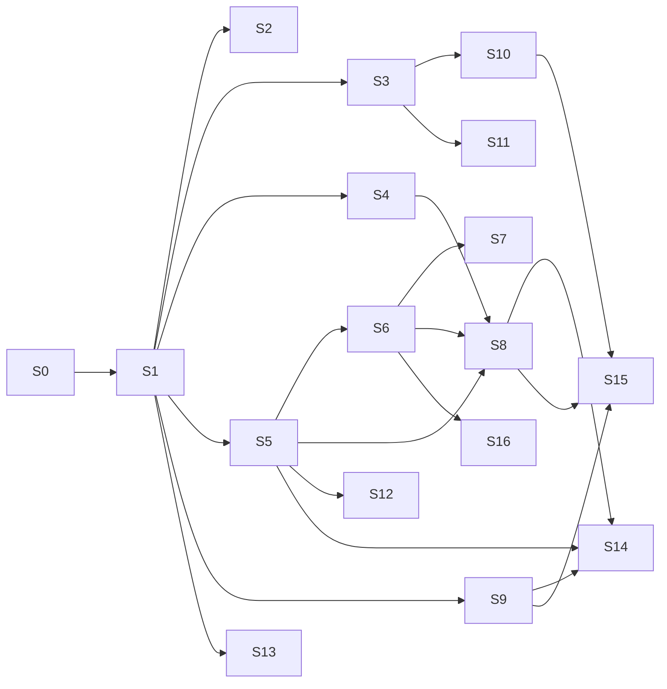

# Roadmap stage plan

This plan breaks the [roadmap](../ROADMAP.md) into stages, sub-stages, and tasks with their dependencies, so it is clear where the project is going, what each stage includes, and which work can run in parallel. It is informative: it assigns no people or agents, sets no dates, and changes as the project learns. The roadmap's checkboxes remain the record of what is done.

## How to read it

- **Stages** are numbered `S0`, `S1`, and so on. Sub-stages are `S4.A`, `S4.B`, and so on. Tasks are `S4.A1`, `S4.A2`, and so on. The Frontend area's own levels are called *UI stage 0–4* to avoid confusion.
- **Class**, following the project's principles:
  - **Core** is domain-neutral and required.
  - **Extension** is optional: adapters, backends, clients, and catalogs. The core works without it.
  - **Example** means presets, bundles, and reference material.
- **Depends on** lists what must be finished first. Tasks with no dependency on each other can run in parallel; the *Parallel lanes* section groups them.
- **Status:** ✅ done · ◐ partial · ☐ planned. Items marked *(proposed)* close gaps found in the project inventory and still need a decision.

## Overview

| Stage | Name | Class | Depends on | Status |
| --- | --- | --- | --- | --- |
| S0 | Stable core | Core | — | ✅ |
| S1 | Application services and HTTP parity | Core | S0 | ✅ |
| S2 | Operator UI, UI stage 0 | Extension | S1 | ✅ |
| S3 | Local usage telemetry | Core | S1 | ✅ |
| S4 | Execution backend abstraction | Core + Extension | S1 | ◐ |
| S5 | Tool and capability contracts | Core | S1 | ◐ |
| S6 | Team definitions and team design | Core | S5.C | ◐ |
| S7 | Collaborative team primitives | Core | S6.A | ◐ |
| S8 | Planning and delegation | Core | S4.A, S5.C, S6.A | ◐ |
| S9 | Interoperability | Extension | S1 (S9.A), S5.A | ◐ |
| S10 | Observability and evaluation | Core + Extension | S3 | ◐ |
| S11 | Model routing and local AI | Core + Extension | S3 | ◐ |
| S12 | Memory, context, and knowledge | Core | S5.A | ◐ |
| S13 | Human-in-the-loop improvements | Core | S1 | ◐ |
| S14 | Operator UI, UI stages 1–3 | Extension | S5, S6.A, S8.B, S9 | ◐ |
| S15 | Advanced operator interface | Extension | S10.B, S9.C, S8.C | ☐ |
| S16 | Presets, examples, and catalog | Extension + Example | S6.A | ◐ |
| S17 | Security, developer experience, and releases | Core (cross-cutting) | — | ◐ |
| S18 | Long-term architecture (M2) | Core | S4–S8 stable | ☐ |

## Parallel lanes

Work in different lanes does not block each other. Inside a lane, follow the dependencies.

| Lane | Stages | Can start now |
| --- | --- | --- |
| Runtime | S4 → S8 | S4.A |
| Contracts and teams | S5 → S6 → S7 | S5.A |
| Interoperability | S9 | S9.A (MCP server only needs S1) |
| Observability and routing | S10, S11 | S10.A, S11.A |
| Human control | S13 | S13.A, S13.B |
| Examples and catalog | S16 | S16.F (reference stacks), S16.G1 (software development example) |
| Cross-cutting | S17 | all tasks |
| Later | S12, S14, S15, S18 | after their dependencies |

**Suggested next wave, in parallel:** S4.A, S5.A, S9.A, S10.A, S13.A, S16.G1, and one S17 task.

---

## Completed stages

### S0 · Stable core ✅

Validation before execution, human review after any step with resume, and definition bundles loaded from outside the package. **Example:** a user brings their own workflow bundle and runs it without changing the core.

### S1 · Application services and HTTP parity ✅

One Python facade (`multiagent.services`) used by the CLI, the HTTP API, and the UI, with generic run requests and structured errors. **Example:** the same run is created from Python, over HTTP, or with `multiagent run`.

### S2 · Operator UI, UI stage 0 ✅

A local browser console in Mock mode by default: create and follow runs, human review and the Human Bridge, artifacts, sequence-numbered events with resynchronization, a restrictive Content Security Policy, and status shown by more than color. The Stage 0 prototype has since been removed.

### S3 · Local usage telemetry ✅

Provider-reported token usage per run, agent, step, and attempt, with duration and failed attempts, readable from Python, HTTP, and the CLI. Local only, never sent anywhere. See [TELEMETRY.md](TELEMETRY.md).

---

## S4 · Execution backend abstraction ◐

- **Class:** Core (interface, native and mock backends) + Extension (Microsoft Agent Framework backend).
- **Objective:** run the same workflow definitions on interchangeable backends.
- **Problem it solves:** today the engine is the only way to execute. Graphs, concurrency, and mature features from other runtimes need a seam that does not change definitions, contracts, runs, or the Human Bridge.
- **Depends on:** S1.

| Task | Description | Depends on |
| --- | --- | --- |
| **S4.A — Interface** | | |
| S4.A1 | ✅ Define the backend interface: execute a step, report events and usage, pause for a human, resume, cancel (`multiagent/backends/`, [`BACKENDS.md`](BACKENDS.md)). | — |
| S4.A2 | ✅ Refactor the native engine behind the interface without behavior changes (`EXECUTION_BACKEND=native`, the default). | S4.A1 |
| S4.A3 | ✅ Make Mock a backend on the same interface (`EXECUTION_BACKEND=mock`). | S4.A1 |
| **S4.B — Conformance** | | |
| S4.B1 | ✅ A backend conformance test suite (events, checkpoints, review, budgets, cancellation, usage): `tests/test_backend_conformance.py`. | S4.A1 |
| S4.B2 | ✅ Run the suite against the native and Mock backends in CI. | S4.A2, S4.A3, S4.B1 |
| **S4.C — Optional backend** | | |
| S4.C1 | Microsoft Agent Framework backend as an optional extra; the core never imports it. | S4.B2 |
| S4.C2 | Compile workflow definitions to its graph workflows (branching, retries, reusable fragments) instead of building a separate graph engine. | S4.C1 |
| **S4.D — Scheduling** | | |
| S4.D1 | ✅ Several workers with controlled concurrency: an atomic claim of queued runs with a lease, limits per process, in total and per project, recovery of expired leases only, and `multiagent worker --concurrency N`. | S4.A2 |
| S4.D2 | A resource-aware scheduler (CPU, RAM, GPU/VRAM, provider limits) that works with any backend. | S4.D1 |

**Parallel:** S4.A2 and S4.A3; S4.C and S4.D after S4.B2.
**Delivered in part:** the interface, the native and Mock backends and the conformance suite (S4.A and S4.B). Runs of a registered bundle still build the native engine directly. Several workers with controlled concurrency (S4.D1) are done. The optional Microsoft Agent Framework backend (S4.C) and the resource-aware scheduler (S4.D2) remain planned.
**Acceptance:** every existing workflow runs unchanged on the native backend; the conformance suite passes for native and Mock; the optional backend installs as an extra and passes the same suite.
**Example:** `multiagent run --backend native` and, with the extra installed, `--backend maf` produce the same run record.

## S5 · Tool and capability contracts ◐

- **Class:** Core.
- **Objective:** agents use tools and deterministic functions through generic, permissioned contracts.
- **Problem it solves:** tools are tied to specific adapters; there is no common permission model or capability vocabulary for assignment and routing.
- **Depends on:** S1.

| Task | Description | Depends on |
| --- | --- | --- |
| **S5.A — Contracts** | | |
| S5.A1 | ✅ Generic tool request, result, error, and permission-request contracts, separate from model adapters (`multiagent/tools/contracts.py`). | — |
| S5.A2 | ◐ Done: an in-memory tool registry with structural validation (`multiagent/tools/registry.py`) and a provider-neutral mapping surface with a deterministic Mock mapper (`multiagent/tools/mapping.py`); no model-provider adapter maps its own tool calls yet. | S5.A1 |
| **S5.B — Permissions** | | |
| S5.B1 | ✅ Tool actions are classed read, write, destructive, or external and checked fail-closed (`ImpactClass` in `multiagent/tools/contracts.py`, `multiagent/tools/permissions.py`); effects such as launching an executor or opening an application need approval evidence. | S5.A1 |
| S5.B2 | ✅ Run-level approvals (escalation, content review, budget cut) and each write or destructive tool call use the existing approve and reject operations: the run waits in `tool_approval` until a person approves that one call by its `permission_request_id`, from the CLI or the GUI (`multiagent/tools/approvals.py`). | S5.B1 |
| **S5.C — Capabilities** | | |
| S5.C1 | ✅ Namespaced capability ids (for example `file.read`) shared by agents, tools, models, and executor descriptors (`multiagent/capabilities.py`). | S5.A1 |
| S5.C2 | ◐ Done: tools are selected by capability from configuration (`multiagent/tools/selection.py`, a step's `tools:` entry), and models and executor surfaces by declared capabilities with deterministic rules; agents are not. | S5.C1 |
| **S5.D — Execution** | | |
| S5.D1 | ✅ Deterministic function steps in workflows: a step names a function registered by trusted code (`multiagent/functions.py`, `core.merge_outputs`), its output is validated against the step contract, and native and mock run it the same way without a provider call; inputs, previews, attempts, reports and the GUI show it as a function (`docs/FUNCTION_STEPS.md`, example `collect_summary`). | S5.A2, S4.A2 |
| S5.D2 | ✅ Tool calls and their outputs are recorded as run events with a safe projection, and run reports have a tools section (`multiagent/tools/trace.py`); executor launches, attempts, and routing evidence are team events. | S5.A2 |
| S5.D3 | ✅ Built-in file tools for one declared folder without Git (`FILE_TOOLS_ROOT`, `multiagent/tools/files.py`): `file.list` and `file.read` read, `file.write` and `file.move` write, so each call waits in `tool_approval`; paths are confined to the folder, `.md`, `.csv`, `.json` and `.txt` in UTF-8, failures carry a stable `details.code`. Checked on every backend that declares `tools` (`tests/test_file_tools_conformance.py`; mock runs without tools) and described in [`FILE_TOOLS.md`](FILE_TOOLS.md). | S5.A2, S5.B2, S5.C2 |
| **S5.E — Guardrails** | | |
| S5.E1 | ✅ Guardrail on outgoing content: a deterministic check of secrets and personal data before each cloud call, with a per-step policy (`egress:` on the step, default `EGRESS_DEFAULT=off`: redact, block, or escalate to a human) and events (`multiagent/egress_guard.py`); local models are skipped unless the policy says `include_local`. | S5.B2 |

**Parallel:** S5.B, S5.C, and S5.D2 after S5.A; S5.E1 after S5.B.
**Acceptance:** a workflow step calls an approved tool through the contract; a destructive action waits for human approval; capabilities select a tool without code changes.
**Example:** a "read file" tool is granted to one role only, and a write needs approval.

## S6 · Team definitions and team design ◐

- **Class:** Core (definitions and runtime) + Extension (generator workflow).
- **Objective:** teams, roles, members, assignments, and relationships as validated data, with an optional generator from a prompt.
- **Problem it solves:** today agents are a flat catalog. There is no organization, no role/member separation, and no way to design a team.
- **Depends on:** S5.C for capabilities; S4.A2 for S6.C.

| Task | Description | Depends on |
| --- | --- | --- |
| **S6.A — Definitions** | | |
| S6.A1 | ✅ Team definition schema: roles (purpose, rules, skills, contracts, capabilities, permissions), members, assignments, relationships (`multiagent/teams/`, an optional `team.yaml` in a bundle). | S5.C1 |
| S6.A2 | ✅ Validation with the bundle rules and least-privilege permissions (`multiagent/teams/validation.py`, in `validate_bundle`, `POST /api/v1/bundles/{name}/validate` and `multiagent bundle-validate`). | S6.A1 |
| S6.A3 | ✅ Human approval before a team is created or changed: versions of a bundle's `team.yaml` (migration 015, `services.teams`), proposed after validation, approved or rejected only by a `user:` actor, with a structural diff against the approved version and decision-register entries; a new run of the bundle records the approved version in a `team_version_bound` event. | S6.A2 |
| **S6.B — Views** | | |
| S6.B1 | ✅ Render the organization chart (for example Mermaid) from relationships: `render_mermaid` in `multiagent/teams/org_chart.py`, a deterministic `flowchart TD` with `reports_to` as the tree and `reviews` and `delegates_to` as dashed links. | S6.A1 |
| S6.B2 | ✅ Organization chart model: a service that returns the tree of positions (role, who holds it, reports) with status, through Python, HTTP, and CLI; validated (no cycles, one root or an explicit forest). See [`TEAMS.md`](TEAMS.md). | S6.A1 |
| **S6.C — Runtime roles** | | |
| S6.C1 | Role switching per step: load the role's rules and context, keep contexts separate, record role and member. | S6.A1, S4.A2 |
| **S6.D — Team design from a prompt** | | |
| S6.D1 | Meta-workflow that generates a team from an objective, or formalizes a described team and asks about gaps. | S6.A3 |
| S6.D2 | Recommended (never mandatory) model bindings per role from the capability catalog and router. | S6.D1, S11.A1 |
| S6.D3 | Regenerate as a reviewable diff and save accepted teams as presets. | S6.D1, S16.A1 |

**Parallel:** S6.B1, S6.B2, and S6.C1 after S6.A1; S6.D after S6.A3.
**Acceptance:** a team file validates, is approved by a human, and runs with role switching recorded in the trace.
**Example:** "a research team of three with a reviewer" becomes a team definition and an org chart for approval.

## S7 · Collaborative team primitives ☐

- **Class:** Core (primitives) + Example (software development preset).
- **Objective:** two or more agents and humans work on shared resources safely.
- **Problem it solves:** coordination (inboxes, proposals, gates, synchronization) exists only as project-specific practice, not as framework capabilities.
- **Depends on:** S6.A.

| Task | Description | Depends on |
| --- | --- | --- |
| **S7.A — Communication** | | |
| S7.A1 | ◐ Append-only team log and per-member inboxes where reading acknowledges. Done: a team event log with per-consumer cursors that move only on explicit acknowledgment ([`TASKS.md`](TASKS.md#event-cursors)). | S6.A1 |
| S7.A2 | ◐ Structured messages and handoffs (delivery, proposal, question, answer, decision, result). Done: task envelopes and results by reference (base, decisions, contract changes, tests not run, requests, patch by sha256) ([`TASKS.md`](TASKS.md#envelopes-and-results)). | S7.A1 |
| **S7.B — Work control** | | |
| S7.B1 | ◐ Done: tasks declare a file scope; a claim locks it and is refused on overlap; a write needs approval for every path. | S6.A1 |
| S7.B2 | ✅ Task reservation with declared resources: claiming a task locks its declared files and rejects overlaps (task services, [`TASKS.md`](TASKS.md)). | S7.B1 |
| S7.B3 | Change proposals in an ordered queue with held drafts; a supervisor applies them. | S7.B1 |
| S7.B4 | ◐ Done: release modes release a dependent only after a delivery with a patch hash, a passing test on that patch, or a verified integration. | S7.B3 |
| **S7.C — Quality gates** | | |
| S7.C1 | ◐ Cross-review and stage gates that close only with passing shared checks and supervisor approval. Done: task gates with ordered checks (local project commands, review by another actor), stored results, and release of dependents only when the gate passes ([`TASKS.md`](TASKS.md#gates)). | S7.B3 |
| S7.C2 | Check results with visibility rules and one designated reader per report. | S7.C1 |
| S7.C3 | Workspace synchronization after each approved stage, with confirmation and no lost work. | S7.C1 |
| **S7.D — Modes and budgets** | | |
| S7.D1 | Supervised and autonomous operating modes. | S7.C1 |
| S7.D2 | Per-member token and cost budgets and minimal-reading rules. | S3, S7.A1 |
| S7.D3 | Resumable status snapshot and readable views of progress and pending decisions. | S7.A2 |

**Parallel:** S7.A and S7.B from the start; S7.D2 in parallel with S7.C.
**Acceptance:** two agents deliver changes to different scoped resources; a supervisor applies them in order; a stage closes only with passing checks.
**Example:** a software development preset where resources are files, changes are patches, and checks are test suites.

## S8 · Planning and delegation ☐

- **Class:** Core (plans, planners interface, assignment) + Extension (LLM or external planners).
- **Objective:** turn an objective into an executable, traceable plan for a user-defined team.
- **Problem it solves:** today every step and order is declared by hand; there is no decomposition, assignment, or replanning.
- **Depends on:** S4.A, S5.C, S6.A.

| Task | Description | Depends on |
| --- | --- | --- |
| **S8.A — Plans as data** | | |
| S8.A1 | ◐ Plan schema: tasks, subtasks, dependencies, capabilities, contracts, assignments, parallel groups, review and integration steps. Done: tasks, groups, and dependencies as data, computed readiness, one transition function, and a team event log ([`TASKS.md`](TASKS.md)). | S6.A1 |
| S8.A2 | Execute plans through the existing engine and backends, not a second engine. | S8.A1, S4.A2 |
| **S8.B — Manual planning** | | |
| S8.B1 | ◐ Done: tasks can be created, given dependencies and scope, paused, resumed, cancelled, or reopened with an expected revision; no manual planner. | S8.A2 |
| S8.B2 | ◐ Done: executor attempts, routing evidence, and results are recorded as team events; reviews and the reason for an assignment are not. | S8.A2 |
| **S8.C — Assignment** | | |
| S8.C1 | ◐ Partial. T15 adds descriptor-based policy preview and guarded claims filtered by declared capabilities, roles, permissions, modes, and privacy. Bundled surfaces remain manual/unknown, so availability and execution are not established. | S8.A1, S5.C2 |
| S8.C2 | ◐ Partial. T14/T15 apply configured mode, permission, privacy, and invocation-budget constraints; unmapped canonical constraints block. ORQ-6 provides task launch, resume, and open operations through disabled-by-default Claude, Codex, and Copilot adapters. CI uses synthetic executables; installed CLI and live account, session, or app behavior have not been verified. See [executor applications](EXECUTORS.md). | S8.C1 |
| **S8.D — Assisted planning** | | |
| S8.D1 | Pluggable planners (manual, deterministic, LLM-based, custom, external). | S8.B1 |
| S8.D2 | Semi-automatic plans that wait for human approval, where users can edit, reassign, or reject them. | S8.D1, S13.B1 |
| S8.D3 | Automatic planning within declared limits. | S8.D2 |
| **S8.E — Adaptation** | | |
| S8.E1 | Replanning on failure, rejection, unavailability, or new information. | S8.D2 |
| S8.E2 | Temporary teams proposed from the agent catalog for approval. | S8.E1, S6.D1 |

**Parallel:** S8.B and S8.C after S8.A.
**Acceptance:** a manual plan with parallel groups runs end to end with a full trace; a semi-automatic plan pauses for approval; constraints are enforced.
**Example:** "prepare a market report" becomes a plan with research in parallel, a synthesis, and a review.

## S9 · Interoperability ◐

- **Class:** Extension (the core defines contracts; protocols live in adapters).
- **Objective:** use the framework from other tools and let it use external tools and applications.
- **Problem it solves:** today the framework is reachable only through its CLI, API, and UI, and only calls model providers.
- **Depends on:** S1 for S9.A; S5.A for the rest.

| Task | Description | Depends on |
| --- | --- | --- |
| **S9.A — MCP server** | | |
| S9.A1 | ◐ Done: a local stdio MCP server over the application services lists workflows, reads run status, pending human steps, and artifacts, and creates a run only when the operator starts it with that permission (`multiagent/interop/mcp_server.py`, extra `mcp`); it does not list agents or answer a human step. | — |
| **S9.B — Channels** | | |
| S9.B1 | Shared-folder channel: file requests and responses with correlation, atomic writes, timeouts, deduplication, permissions, and an audit trail. | S5.A1 |
| S9.B2 | ◐ Done: an application opens after explicit confirmation, and a task runs in it through its command line; no prompt clipboard flow. | S9.B1 |
| **S9.C — Clients** | | |
| S9.C1 | ◐ Done: an MCP client through the official SDK registers the tools of operator-configured stdio servers in the tool registry, with impact only the operator can lower (`multiagent/tools/mcp_client.py`); it is a Python API, not yet configurable from settings, a bundle, or the CLI. | S5.A2 |
| S9.C2 | A2A adapter when a concrete need appears. | S5.A2 |
| **S9.D — Applications** | | |
| S9.D1 | ◐ Done: launching and opening an application are separate effects with separate approvals. | S5.B2 |
| S9.D2 | ◐ Done: independent adapters for three agent applications, disabled by default; no design, CAD, or media adapters. | S9.D1 |

**Parallel:** S9.A right away; S9.B and S9.C after S5.A.
**Acceptance:** an MCP client can list workflows and start a run; a shared-folder request round-trips with a receipt.
**Example:** an editor with MCP support starts a review run and answers its human step.

## S10 · Observability and evaluation ◐

- **Class:** Core (records and reports) + Extension (exporters).
- **Objective:** understand, compare, and audit runs.
- **Depends on:** S3 ✅.

| Task | Description | Depends on |
| --- | --- | --- |
| **S10.A — Telemetry** | | |
| S10.A1 | ◐ Partial. Routing decisions, requested/applied effort, bounded-escalation events, and estimated call cost from token counts and valid catalog price evidence are recorded; retries and token estimates are not yet fully delivered. | — |
| S10.A2 | ✅ Exportable run reports in JSON or Markdown (`multiagent run-report`, `GET /api/v1/runs/{run_id}/report`, `multiagent/services/reports.py`); usage records export as JSONL and routing runs as normalized JSONL or CSV. | — |
| **S10.B — Standards** | | |
| S10.B1 | ◐ Partial: telemetry attaches through the backend interface; native emits run, step, provider call and tool call spans, while Mock emits run, step and zero-token chat spans. Token and duration metrics use GenAI attributes; telemetry is optional and off by default. | S10.A1, S4.A1 |
| **S10.C — Evaluation** | | |
| S10.C1 | ✅ Evaluation sets of workflow, agent or versioned-prompt cases with deterministic checks (`multiagent/evaluation/`, `services.evaluation`, `multiagent eval run`, `POST /api/v1/evaluations/run`, `docs/EVALUATION.md`). Mock runs on a temporary database; a live workflow set runs on the server's worker with a timeout. | — |
| S10.C2 | ✅ Regression tracking when prompts, models, workflows, or providers change (saved evaluation runs, a baseline per set and `compare` in Python, HTTP and `multiagent eval compare`, which exits 3 on a regression, and the read-only «Evaluación» view of the GUI with the sets, their runs and the latest run against the baseline; see `docs/EVALUATION.md`). | S10.C1 |
| S10.C3 | ◐ Done: an offline tool compares paired runs of two routes; it is not a local-versus-cloud benchmark. | S10.C1, S11.B1 |
| **S10.D — Diagnostics** | | |
| S10.D1 | ◐ Done: an installation report covers agent applications and requirements, the doctor reports GPU and provider health, and executor versions are checked against pins. | — |

**Parallel:** S10.A, S10.C1, and S10.D1 at once.
**Acceptance:** a run exports a report and an OpenTelemetry trace; a prompt change shows a regression score.

**Delivered in part:** provider-call cost estimates are recorded with their price
basis, with unknown values kept separate from zero. Routing and bounded
escalation events provide decision evidence. Runs export a report, and
evaluation sets exist as a Python API; complete retry/token-estimate
telemetry and evaluation from the CLI or HTTP remain planned. The
optional OpenTelemetry traces and metrics attach to each execution backend
(S4.A1): native and Mock.

## S11 · Model routing and local AI ◐

- **Class:** Core (policies) + Extension (local model providers).
- **Objective:** choose the right model per task and reduce dependence on paid cloud inference.
- **Depends on:** S3 ✅.

| Task | Description | Depends on |
| --- | --- | --- |
| **S11.A — Policies** | | |
| S11.A1 | ◐ Partial. T14 provides opt-in profiles, deterministic candidate filters, evidence-aware health selection, and comparable-price selection when evidence permits. The disabled-by-default economic profile applies levels, classification, and current price evidence; it does not establish provider availability or served-model outcomes. | — |
| S11.A2 | Local-first, cloud-first, offline-only, and hybrid policies. | S11.A1 |
| S11.A3 | ◐ Partial. T14 enforces run/profile provider-invocation limits across dispatch attempts. The economic profile checks budgets before bounded escalation; strict token/cost enforcement and actual billing guarantees remain unsupported. | S11.A1 |
| **S11.B — Model health** | | |
| S11.B1 | ◐ Partial. Economic-profile escalation moves up one level, at most once per attempt, only after output-quality failures; provider errors do not escalate and T4 is never reached automatically. | — |
| S11.B2 | ◐ Done: per-run attempt, failure, and duration statistics per model; they do not feed routing. | S11.B1, S10.A1 |
| **S11.C — Local models** | | |
| S11.C1 | Evaluate and add complementary local language models by strength. | S11.B1 |
| S11.C2 | Local embeddings and retrieval. | S11.C1 |
| S11.C3 | Evaluate local image and video generation. | S11.C1 |
| S11.C4 | GPU/VRAM-aware selection and fully offline workflows. | S11.C1, S4.D2 |
| **S11.D — Optional providers** | | |
| S11.D1 | Evaluate external structured-decision providers behind a neutral interface, opt-in only. | S11.A1 |
| **S11.E — Cost reduction** | | |
| S11.E1 | Stable prompt prefix: place system text, skills, and output contract before variable input for provider prompt caching, and record cached tokens when reported. | S3, S11.A1 |
| S11.E2 | Opt-in step result cache keyed by prompt hash, input, model, and contract version; off for human and non-deterministic steps. | S11.E1, S3 |
| S11.E3 | Embedding cache by content hash, model, and version; deliver with retrieval over project files. | S11.C2, S12.C1 |

**Parallel:** S11.A and S11.B at once.

Semantic caching remains an evaluation question only: assess whether its risk of returning a wrong answer is worthwhile; no adoption decision.

**Delivered in part:** the catalog supports model levels (T1–T4),
classification, and validity-bounded pricing evidence; local Ollama models
declare T1 and no-charge prices. Workflow steps carry `kind` and provider
translated `effort`. A disabled-by-default economic profile selects among
eligible priced models and supports bounded, supervised or automatic
escalation. Offline measurement tools apply the approved paired-run adoption
criterion; real measurements require user authorization and budget. Codex,
Claude, and Copilot CLI executor adapters can receive routing decisions within
their declared support. ORQ-6 provides their task launch path, but the adapters
remain disabled by default. CI uses synthetic executables; installed CLI and live
account, session, or app behavior have not been verified. Broader health
discovery, local model expansion, and the other planned items remain open. See
[executor applications](EXECUTORS.md).

## S12 · Memory, context, and knowledge ◐

- **Class:** Core.
- **Objective:** explicit, minimal, and private context instead of hidden model memory.
- **Depends on:** S5.A; S11.C2 for S12.C.

| Task | Description | Depends on |
| --- | --- | --- |
| **S12.A — Scope** | | |
| S12.A1 | ◐ Done: project memory entries (facts, decisions, conventions) with author provenance, computed trust and confidence, stored in SQLite (migration 014) and managed by CLI and API (`multiagent memory`, `/api/v1/projects/{project}/memory`); a workflow or step that sets `project_memory` receives them quoted as data under a size cap, off by default. No structured project context beyond these entries, no embeddings or search (S12.C1). | — |
| S12.A2 | ◐ Done: provenance and trust levels for content, summaries verified when read, task packages invalidated by a fingerprint. | S12.A1 |
| **S12.B — Propagation** | | |
| S12.B1 | ◐ Done: older step outputs are replaced by a validated summary when a context profile is enabled; the five policies per step are not offered. | S12.A1 |
| S12.B2 | ✅ Per-task packages carry a fingerprint and answer "unchanged"; a snapshot package carries only events after its cursor. | S12.B1 |
| **S12.C — Knowledge** | | |
| S12.C1 | Reusable knowledge packs and retrieval over project files; deliver embedding caching with this task. | S12.A1, S11.C2 |
| S12.C2 | ◐ Done: validated summaries of run context and task history; no retrieval. | S12.C1 |
| **S12.D — Research** | | |
| S12.D1 | ◐ Done: a general research example bundle; no source tracking or freshness. | S12.C1 |

## S13 · Human-in-the-loop improvements ◐

- **Class:** Core.
- **Objective:** human control as a first-class, auditable part of every run.
- **Depends on:** S1 ✅.

| Task | Description | Depends on |
| --- | --- | --- |
| **S13.A — Review** | | |
| S13.A1 | ◐ Done: pending decisions appear as cards in the GUI and settle through approve and reject. | — |
| S13.A2 | ✅ Revision history and comparisons between attempts (`step_attempts`, `compare_attempts`, `multiagent attempts`, «Comparar» in the GUI run detail). Failed attempts without output and the full prompt sent to a model are not stored yet. | — |
| S13.A3 | ✅ Comments and structured feedback passed safely into later attempts (`comments` on a change request, with quotes of the output wrapped as untrusted data; who and which channel are recorded). | S13.A2 |
| **S13.B — Policy** | | |
| S13.B1 | ◐ Done: supervised or automatic escalation per workflow step, a cutting or warning budget, and a content-review policy; no risk level or project. | S5.B1 |
| S13.B2 | ✅ A register of proposals and decisions with state and validity (migration `016_decisions.sql`, `services.decisions`, `/api/v1/decisions`, `multiagent decision`); run reviews are recorded automatically. | — |
| **S13.C — External output** | | |
| S13.C1 | ✅ Improve the human-guided external model flow across CLI, API, and UI (`human-check` without writing, `expected_schema` and `request_path` in `human-next`, `prompt_used` in the GUI, `research-submit` in the API, one `invalid_state` with `details.reason=not_waiting` for a stale wait; see `docs/HUMAN_GUIDED.md`). | — |
| S13.C2 | ✅ Replace a step with externally produced output, with manifest, hashes, preview and attached evidence (screenshots, recordings, logs) referenced from the artifact manifest, confirmation, and receipt (`external-output preview` and `confirm` in Python, HTTP, the CLI and the GUI, native and mock; see `docs/HUMAN_GUIDED.md`). | S13.C1 |
| **S13.D — Audit** | | |
| S13.D1 | ◐ Done: provenance kinds for user, model, tool, and executor content; not yet an audit trail of outputs. | S5.D2 |

**External executors (S13.C):** whoever produces the external output (a person, a cloud agent, a vendor's always-on agent) is outside the framework, which only validates the artifact. Document and mitigate:
- **Data leakage:** the delivered prompt may carry project context, personal data, or secrets; apply per-step context propagation (S12.B1) and sanitization (S17.3) before handing it over, and never credentials (S17.1).
- **Outgoing provider calls:** the S5.E1 guardrail checks prompts for secrets and personal data before cloud calls when a step or `EGRESS_DEFAULT` turns it on; incoming untrusted-content screening does not provide this protection.
- **Provenance:** the pasted result does not prove who produced it or with which model; the receipt records `executor: external` with a self-declared label and the hashes of the delivered prompt and the result, without authenticating.
- **Instructions in the result:** the result is data; it is validated against the contract and nothing inside it is ever executed.
- **Side actions of the executor:** an executor with connected apps may act outside the framework while "running" the step (send mail, open pull requests); governing that is the user's responsibility on the external platform.
- **Provider retention and training:** the external provider may retain the content or use it for training depending on the plan and settings; say so in the documentation.
- **Cost and telemetry:** external work does not appear in the framework's telemetry; the step is marked `external, usage unknown` instead of inferring usage.

**Parallel:** S13.A, S13.B2, and S13.C at once.

## S14 · Operator UI, UI stages 1–3 ◐

- **Class:** Extension (API client).
- **Objective:** grow the operator UI only where it improves validation and operation.

**Delivered in part:** a local operator GUI at `/gui/` with a read-only,
configurable session viewer, framework-run creation and human actions, live
session follow, and confirmation-gated open-in-app support. It uses the local
API with a bearer token and is documented in [GUI.md](GUI.md). The Stage 0
prototype has been removed. This does not
complete UI stages 1–3; the configuration, teams/plans/tasks, tools, and
advanced visualization items below remain planned.

| Task | Description | Depends on |
| --- | --- | --- |
| S14.1 | ◐ Done: documented GUI extension seam and public API error format; no decision record, no event-transport evaluation. | — |
| S14.2 | ◐ Done: workflow inputs and per-run routing preferences in the GUI. | S5.C1, S6.A1, S14.1 |
| S14.3 | UI stage 2: teams, plans, and tasks, with plan approval and task progress. | S8.B1, S14.2 |
| S14.4 | UI stage 3: tools and interoperability: pending permissions, channels, MCP. | S5.B2, S9.C1, S14.2 |
| S14.5 | ◐ Done: runs, projects, run history, and a work map; no artifact previews or comparisons. | S14.1 |
| S14.6 | ◐ Done: plan usage, tokens per app, model, and level, and estimated cost; no latency, routing, or hardware views. | S10.A1, S14.1 |
| S14.7 | Administrative views for workers, migrations, diagnostics, and recovery. | S4.D1, S14.1 |
| S14.8 | Sanitized rich rendering (Markdown or HTML) for any future UI. | S14.1 |
| S14.9 | Organization chart view: position cards (role above, holder below: agent, human, or model, with a status shown as text and shape, not color alone), drawn with no dependencies from S6.B2, keyboard accessible, and within the Content Security Policy. If S14.1 chooses another frontend, it follows that decision. | S6.B2, S14.1, S14.2 |

**Parallel:** S14.5, S14.6, and S14.8 after S14.1, alongside the UI stages.

## S15 · Advanced operator interface ☐

- **Class:** Extension.
- **Objective:** follow large, long-running teams live without freezing the browser.
- **Depends on:** S10.B1 (OpenTelemetry), S9.C1 (MCP), S8.C (concurrent agents), S14.1.

| Task | Description | Depends on |
| --- | --- | --- |
| S15.A1 | Architecture decision and measurable performance targets. | S14.1 |
| S15.B1 | Background event ingestion with out-of-order tolerance by sequence number. | S15.A1 |
| S15.B2 | Client state machines that mirror the core and resynchronize from snapshots. | S15.B1 |
| S15.C1 | Macro view (force-directed graph), meso view (task graph), and semantic zoom. | S15.B2 |
| S15.C2 | Detail panel with progressive disclosure; sparklines; virtualization. | S15.B2 |
| S15.D1 | OpenTelemetry and MCP views with provider-neutral schemas; standard human-action payloads. | S15.B2, S10.B1, S9.C1 |
| S15.E1 | Accessible design system (WCAG 2.2 AA baseline, APCA evaluation). | S15.A1 |

**Parallel:** S15.C, S15.D, and S15.E after S15.B2.

## S16 · Presets, examples, and catalog ◐

- **Class:** Extension (package format, catalog) + Example (presets).
- **Objective:** shareable, validated presets and realistic examples that keep the core domain-neutral.

| Task | Description | Depends on |
| --- | --- | --- |
| **S16.A — Package** | | |
| S16.A1 | Portable, versioned preset format with a manifest (compatibility, capabilities, permissions). | S6.A1 |
| S16.A2 | ◐ Done: bundles are validated before they run; there is no install, update, or removal. | S16.A1 |
| S16.A3 | Trust rules for executable content (show, verify, sandbox) and private overlays. | S16.A2 |
| S16.A4 | Searchable community catalog. | S16.A2 |
| **S16.F — Reference stacks** | | |
| S16.F1 | Top five team types, evaluation criteria, and three to five reference tools each; publish and review periodically. | — |
| **S16.G — Examples** | | |
| S16.G1 | ◐ Runnable in Mock with seven roles and two human reviews; resources, patches, and commits are not modeled. | — |
| S16.G2 | *(proposed)* Move the branding and asset domain out of the core package into a preset. | — |
| S16.G3 | Content and research presets on the preset format. | S16.A1, S16.G2 |
| S16.G4 | *(proposed)* A library of objectives or requests to start runs from, if it proves useful. | S16.A1 |

**Parallel:** S16.F1, S16.G1, and S16.G2 right away; S16.A after S6.A1.

## S17 · Security, developer experience, and releases ◐

- **Class:** Core (cross-cutting); can run at any time.

| Task | Description | Depends on |
| --- | --- | --- |
| S17.1 | ◐ Done: opt-in profiles keep sensitive data classes off cloud models; no secret manager beyond `.env`. | — |
| S17.2 | Dependency, secret, and static-analysis checks in CI. | — |
| S17.3 | ◐ Done: untrusted content quoting, detection, quarantine and review; telemetry stays local. Outgoing prompt screening is S5.E1 (opt-in). | — |
| S17.4 | ◐ Done: CI builds and installs the wheel in a clean environment on Ubuntu; no containers. | — |
| S17.5 | ◐ Done: API reference and three runnable examples; no framework-equivalence page. | S4.C1 for the equivalences |
| S17.6 | ◐ Done: numbered database migrations with upgrade tests; configuration, prompts, and workflows are not covered. | — |
| S17.7 | ◐ Done: most new files carry SPDX headers and CI checks versions; no release automation or governance review. | — |

## S18 · Long-term architecture (M2) ☐

A new product generation only when compatibility with M1 cannot reasonably be kept: a major runtime, contract, persistence, distributed-execution, or backend/frontend redesign. Depends on S4–S8 being stable.
