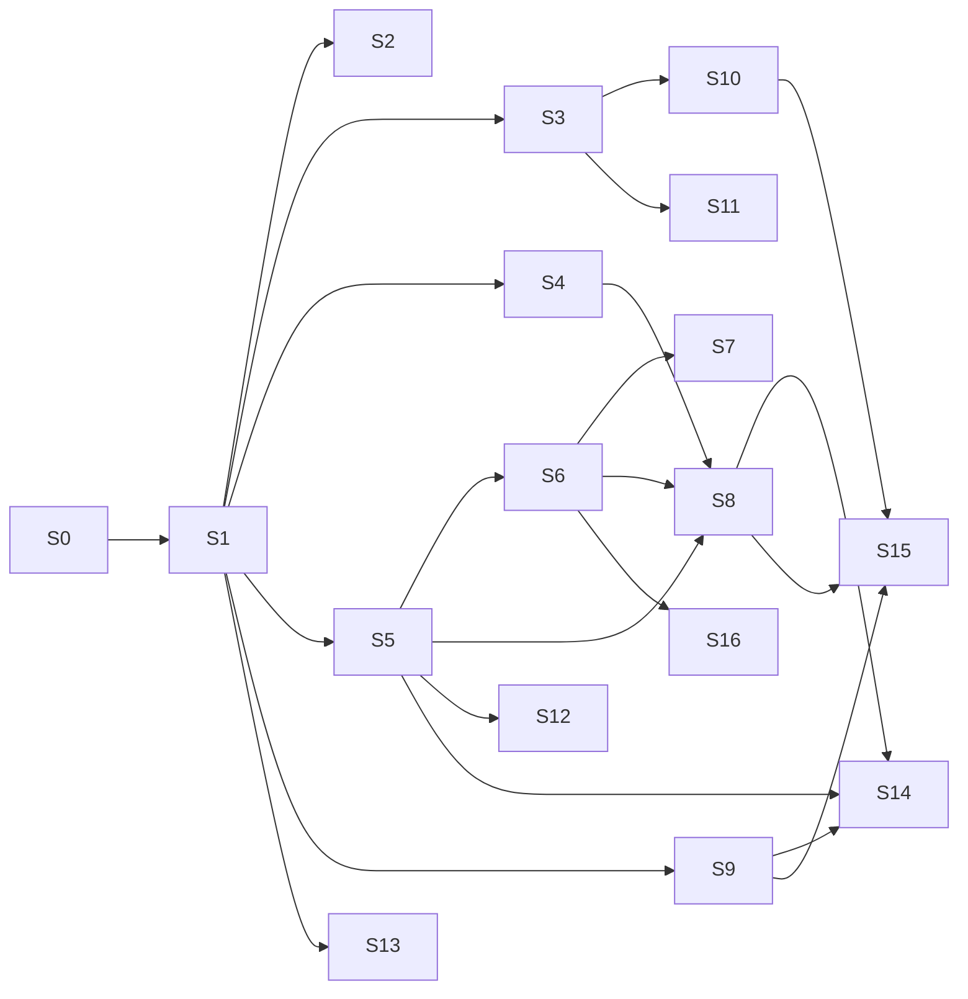

# Roadmap stage plan

This plan breaks the [roadmap](../ROADMAP.md) into stages, sub-stages, and tasks with their dependencies, so it is clear where the project is going, what each stage includes, and which work can run in parallel. It is informative: it assigns no people or agents, sets no dates, and changes as the project learns. The roadmap's checkboxes remain the record of what is done.

## How to read it

- **Stages** are numbered `S0`, `S1`, and so on. Sub-stages are `S4.A`, `S4.B`, and so on. Tasks are `S4.A1`, `S4.A2`, and so on. The Frontend area's own levels are called *UI stage 0–4* to avoid confusion.
- **Class**, following the project's principles:
  - **Core** is domain-neutral and required.
  - **Extension** is optional: adapters, backends, clients, and catalogs. The core works without it.
  - **Example** means presets, bundles, and reference material.
- **Depends on** lists what must be finished first. Tasks with no dependency on each other can run in parallel; the *Parallel lanes* section groups them.
- **Status:** ✅ done · ◐ partial · ☐ planned. Items marked *(proposed)* close gaps found in the project inventory and still need a decision.

## Overview

| Stage | Name | Class | Depends on | Status |
| --- | --- | --- | --- | --- |
| S0 | Stable core | Core | — | ✅ |
| S1 | Application services and HTTP parity | Core | S0 | ✅ |
| S2 | Operator UI, UI stage 0 | Extension | S1 | ✅ |
| S3 | Local usage telemetry | Core | S1 | ✅ |
| S4 | Execution backend abstraction | Core + Extension | S1 | ◐ |
| S5 | Tool and capability contracts | Core | S1 | ◐ |
| S6 | Team definitions and team design | Core | S5.C | ◐ |
| S7 | Collaborative team primitives | Core | S6.A | ◐ |
| S8 | Planning and delegation | Core | S4.A, S5.C, S6.A | ◐ |
| S9 | Interoperability | Extension | S1 (S9.A), S5.A | ◐ |
| S10 | Observability and evaluation | Core + Extension | S3 | ◐ |
| S11 | Model routing and local AI | Core + Extension | S3 | ◐ |
| S12 | Memory, context, and knowledge | Core | S5.A | ◐ |
| S13 | Human-in-the-loop improvements | Core | S1 | ◐ |
| S14 | Operator UI, UI stages 1–3 | Extension | S5, S6.A, S8.B, S9 | ◐ |
| S15 | Advanced operator interface | Extension | S10.B, S9.C, S8.C | ☐ |
| S16 | Presets, examples, and catalog | Extension + Example | S6.A | ◐ |
| S17 | Security, developer experience, and releases | Core (cross-cutting) | — | ◐ |
| S18 | Long-term architecture (M2) | Core | S4–S8 stable | ☐ |

## Parallel lanes

Work in different lanes does not block each other. Inside a lane, follow the dependencies.

| Lane | Stages | Can start now |
| --- | --- | --- |
| Runtime | S4 → S8 | S4.A |
| Contracts and teams | S5 → S6 → S7 | S5.A |
| Interoperability | S9 | S9.A (MCP server only needs S1) |
| Observability and routing | S10, S11 | S10.A, S11.A |
| Human control | S13 | S13.A, S13.B |
| Examples and catalog | S16 | S16.F (reference stacks), S16.G1 (software development example) |
| Cross-cutting | S17 | all tasks |
| Later | S12, S14, S15, S18 | after their dependencies |

**Suggested next wave, in parallel:** S4.A, S5.A, S9.A, S10.A, S13.A, S16.G1, and one S17 task.

---

## Completed stages

### S0 · Stable core ✅

Validation before execution, human review after any step with resume, and definition bundles loaded from outside the package. **Example:** a user brings their own workflow bundle and runs it without changing the core.

### S1 · Application services and HTTP parity ✅

One Python facade (`multiagent.services`) used by the CLI, the HTTP API, and the UI, with generic run requests and structured errors. **Example:** the same run is created from Python, over HTTP, or with `multiagent run`.

### S2 · Operator UI, UI stage 0 ✅

A local browser console in Mock mode by default: create and follow runs, human review and the Human Bridge, artifacts, sequence-numbered events with resynchronization, a restrictive Content Security Policy, and status shown by more than color. The Stage 0 prototype has since been removed.

### S3 · Local usage telemetry ✅

Provider-reported token usage per run, agent, step, and attempt, with duration and failed attempts, readable from Python, HTTP, and the CLI. Local only, never sent anywhere. See [TELEMETRY.md](TELEMETRY.md).

---

## S4 · Execution backend abstraction ◐

- **Class:** Core (interface, native and mock backends) + Extension (Microsoft Agent Framework backend).
- **Objective:** run the same workflow definitions on interchangeable backends.
- **Problem it solves:** today the engine is the only way to execute. Graphs, concurrency, and mature features from other runtimes need a seam that does not change definitions, contracts, runs, or the Human Bridge.
- **Depends on:** S1.

| Task | Description | Depends on |
| --- | --- | --- |
| **S4.A — Interface** | | |
| S4.A1 | ✅ Define the backend interface: execute a step, report events and usage, pause for a human, resume, cancel (`multiagent/backends/`, [`BACKENDS.md`](BACKENDS.md)). | — |
| S4.A2 | ✅ Refactor the native engine behind the interface without behavior changes (`EXECUTION_BACKEND=native`, the default). | S4.A1 |
| S4.A3 | ✅ Make Mock a backend on the same interface (`EXECUTION_BACKEND=mock`). | S4.A1 |
| **S4.B — Conformance** | | |
| S4.B1 | ✅ A backend conformance test suite (events, checkpoints, review, budgets, cancellation, usage): `tests/test_backend_conformance.py`. | S4.A1 |
| S4.B2 | ✅ Run the suite against the native and Mock backends in CI. | S4.A2, S4.A3, S4.B1 |
| **S4.C — Optional backend** | | |
| S4.C1 | Microsoft Agent Framework backend as an optional extra; the core never imports it. | S4.B2 |
| S4.C2 | Compile workflow definitions to its graph workflows (branching, retries, reusable fragments) instead of building a separate graph engine. | S4.C1 |
| **S4.D — Scheduling** | | |
| S4.D1 | ✅ Several workers with controlled concurrency: an atomic claim of queued runs with a lease, limits per process, in total and per project, recovery of expired leases only, and `multiagent worker --concurrency N`. | S4.A2 |
| S4.D2 | A resource-aware scheduler (CPU, RAM, GPU/VRAM, provider limits) that works with any backend. | S4.D1 |

**Parallel:** S4.A2 and S4.A3; S4.C and S4.D after S4.B2.
**Delivered in part:** the interface, the native and Mock backends and the conformance suite (S4.A and S4.B). Runs of a registered bundle still build the native engine directly. Several workers with controlled concurrency (S4.D1) are done. The optional Microsoft Agent Framework backend (S4.C) and the resource-aware scheduler (S4.D2) remain planned.
**Acceptance:** every existing workflow runs unchanged on the native backend; the conformance suite passes for native and Mock; the optional backend installs as an extra and passes the same suite.
**Example:** `multiagent run --backend native` and, with the extra installed, `--backend maf` produce the same run record.

## S5 · Tool and capability contracts ◐

- **Class:** Core.
- **Objective:** agents use tools and deterministic functions through generic, permissioned contracts.
- **Problem it solves:** tools are tied to specific adapters; there is no common permission model or capability vocabulary for assignment and routing.
- **Depends on:** S1.

| Task | Description | Depends on |
| --- | --- | --- |
| **S5.A — Contracts** | | |
| S5.A1 | ✅ Generic tool request, result, error, and permission-request contracts, separate from model adapters (`multiagent/tools/contracts.py`). | — |
| S5.A2 | ◐ Done: an in-memory tool registry with structural validation (`multiagent/tools/registry.py`) and a provider-neutral mapping surface with a deterministic Mock mapper (`multiagent/tools/mapping.py`); no model-provider adapter maps its own tool calls yet. | S5.A1 |
| **S5.B — Permissions** | | |
| S5.B1 | ✅ Tool actions are classed read, write, destructive, or external and checked fail-closed (`ImpactClass` in `multiagent/tools/contracts.py`, `multiagent/tools/permissions.py`); effects such as launching an executor or opening an application need approval evidence. | S5.A1 |
| S5.B2 | ✅ Run-level approvals (escalation, content review, budget cut) and each write or destructive tool call use the existing approve and reject operations: the run waits in `tool_approval` until a person approves that one call by its `permission_request_id`, from the CLI or the GUI (`multiagent/tools/approvals.py`). | S5.B1 |
| **S5.C — Capabilities** | | |
| S5.C1 | ✅ Namespaced capability ids (for example `file.read`) shared by agents, tools, models, and executor descriptors (`multiagent/capabilities.py`). | S5.A1 |
| S5.C2 | ◐ Done: tools are selected by capability from configuration (`multiagent/tools/selection.py`, a step's `tools:` entry), and models and executor surfaces by declared capabilities with deterministic rules; agents are not. | S5.C1 |
| **S5.D — Execution** | | |
| S5.D1 | ✅ Deterministic function steps in workflows: a step names a function registered by trusted code (`multiagent/functions.py`, `core.merge_outputs`), its output is validated against the step contract, and native and mock run it the same way without a provider call; inputs, previews, attempts, reports and the GUI show it as a function (`docs/FUNCTION_STEPS.md`, example `collect_summary`). A function that raises now fails with a reason: the exception type and message on one line, redacted by the secrets gate and cut to 300 characters, never the traceback, shown in the `workflow_failed` event and in the run thread (`function_output_invalid` still has none). A package of level `code` may bring a `functions.py`, imported only with explicit trust after the scan (`multiagent gui --trust-functions NAME`, valid for that start, or `trust_functions` in the installed registry, tied to the fingerprint); a package cannot register as `core`, and the API and the MCP server never grant trust. | S5.A2, S4.A2 |
| S5.D2 | ✅ Tool calls and their outputs are recorded as run events with a safe projection, and run reports have a tools section (`multiagent/tools/trace.py`); executor launches, attempts, and routing evidence are team events. | S5.A2 |
| S5.D3 | ✅ Built-in file tools for one declared folder without Git (`FILE_TOOLS_ROOT`, `multiagent/tools/files.py`): `file.list` and `file.read` read, `file.write` and `file.move` write, so each call waits in `tool_approval`; paths are confined to the folder, `.md`, `.csv`, `.json` and `.txt` in UTF-8, failures carry a stable `details.code`. Checked on every backend that declares `tools` (`tests/test_file_tools_conformance.py`; mock runs without tools) and described in [`FILE_TOOLS.md`](FILE_TOOLS.md). | S5.A2, S5.B2, S5.C2 |
| **S5.E — Guardrails** | | |
| S5.E1 | ✅ Guardrail on outgoing content: a deterministic check of secrets and personal data before each cloud call, with a per-step policy (`egress:` on the step, default `EGRESS_DEFAULT=off`: redact, block, or escalate to a human) and events (`multiagent/egress_guard.py`); local models are skipped unless the policy says `include_local`. The secret gate (`multiagent/secret_gate.py`) is always on, whatever `EGRESS_DEFAULT` says: before a non-local model call, and before every executor launch and resume, a likely private key, secret key, bearer token or long token holds the send until a person approves that exact text with one click in the GUI (see `docs/security/secret-gate.md`). The rest of the guardrail stays opt-in. | S5.B2 |

**Parallel:** S5.B, S5.C, and S5.D2 after S5.A; S5.E1 after S5.B.
**Acceptance:** a workflow step calls an approved tool through the contract; a destructive action waits for human approval; capabilities select a tool without code changes.
**Example:** a "read file" tool is granted to one role only, and a write needs approval.

## S6 · Team definitions and team design ◐

- **Class:** Core (definitions and runtime) + Extension (generator workflow).
- **Objective:** teams, roles, members, assignments, and relationships as validated data, with an optional generator from a prompt.
- **Problem it solves:** today agents are a flat catalog. There is no organization, no role/member separation, and no way to design a team.
- **Depends on:** S5.C for capabilities; S4.A2 for S6.C.

| Task | Description | Depends on |
| --- | --- | --- |
| **S6.A — Definitions** | | |
| S6.A1 | ✅ Team definition schema: roles (purpose, rules, skills, contracts, capabilities, permissions), members, assignments, relationships (`multiagent/teams/`, an optional `team.yaml` in a bundle). | S5.C1 |
| S6.A2 | ✅ Validation with the bundle rules and least-privilege permissions (`multiagent/teams/validation.py`, in `validate_bundle`, `POST /api/v1/bundles/{name}/validate` and `multiagent bundle-validate`). | S6.A1 |
| S6.A3 | ✅ Human approval before a team is created or changed: versions of a bundle's `team.yaml` (migration 015, `services.teams`), proposed after validation, approved or rejected only by a `user:` actor, with a structural diff against the approved version and decision-register entries; a new run of the bundle records the approved version in a `team_version_bound` event. | S6.A2 |
| **S6.B — Views** | | |
| S6.B1 | ✅ Render the organization chart (for example Mermaid) from relationships: `render_mermaid` in `multiagent/teams/org_chart.py`, a deterministic `flowchart TD` with `reports_to` as the tree and `reviews` and `delegates_to` as dashed links. | S6.A1 |
| S6.B2 | ✅ Organization chart model: a service that returns the tree of positions (role, who holds it, reports) with status, through Python, HTTP, and CLI; validated (no cycles, one root or an explicit forest). See [`TEAMS.md`](TEAMS.md). | S6.A1 |
| **S6.C — Runtime roles** | | |
| S6.C1 | ✅ Model steps bind a role from the approved team version fixed at run creation, load that role's rules and skills without mixing role instructions, and record role and member in the trace, attempts, report, and GUI ([`TEAMS.md`](TEAMS.md#roles-in-workflow-steps)). Permission validation for role-bound steps with `agent: null` remains open. | S6.A1, S4.A2 |
| **S6.D — Team design from a prompt** | | |
| S6.D1 | Meta-workflow that generates a team from an objective, or formalizes a described team and asks about gaps. | S6.A3 |
| S6.D2 | Recommended (never mandatory) model bindings per role from the capability catalog and router. | S6.D1, S11.A1 |
| S6.D3 | Regenerate as a reviewable diff and save accepted teams as presets. | S6.D1, S16.A1 |
| **S6.E — Offices** | | |
| S6.E1 | ◐ Done: an office is data (`office.yaml`, `maf.office/1`): areas as bundles named `<office>__<area>`, relations, a default plan, per-area sensitivity and required capabilities; contracts can be data (`contracts.yaml`); an orchestrator proposes plans over the office's areas and never sends a request of an office that is not all normal to a cloud model. | S6.A3, S16.A2 |
| S6.E2 | ◐ Done: install, reimport, remove and export an office through Python, API, CLI and the GUI; a data-only office installs without code, one install card with at most two decisions approves the teams, and exports follow an allow-list with a manifest and the secret gate. | S6.E1 |

**Parallel:** S6.B1, S6.B2, and S6.C1 after S6.A1; S6.D after S6.A3.
**Acceptance:** a team file validates, is approved by a human, and runs with role switching recorded in the trace.
**Example:** "a research team of three with a reviewer" becomes a team definition and an org chart for approval.

## S7 · Collaborative team primitives ◐

- **Class:** Core (primitives) + Example (software development preset).
- **Objective:** two or more agents and humans work on shared resources safely.
- **Problem it solves:** coordination (inboxes, proposals, gates, synchronization) exists only as project-specific practice, not as framework capabilities.
- **Depends on:** S6.A.

| Task | Description | Depends on |
| --- | --- | --- |
| **S7.A — Communication** | | |
| S7.A1 | ◐ Append-only team log and per-member inboxes where reading acknowledges. Done: a team event log with per-consumer cursors that move only on explicit acknowledgment ([`TASKS.md`](TASKS.md#event-cursors)). | S6.A1 |
| S7.A2 | ◐ Structured messages and handoffs (delivery, proposal, question, answer, decision, result). Done: task envelopes and results by reference (base, decisions, contract changes, tests not run, requests, patch by sha256) ([`TASKS.md`](TASKS.md#envelopes-and-results)). | S7.A1 |
| **S7.B — Work control** | | |
| S7.B1 | ◐ Done: tasks declare a file scope; a claim locks it and is refused on overlap; a write needs approval for every path. | S6.A1 |
| S7.B2 | ✅ Task reservation with declared resources: claiming a task locks its declared files and rejects overlaps (task services, [`TASKS.md`](TASKS.md)). | S7.B1 |
| S7.B3 | Change proposals in an ordered queue with held drafts; a supervisor applies them. | S7.B1 |
| S7.B4 | ◐ Done: release modes release a dependent only after a delivery with a patch hash, a passing test on that patch, or a verified integration. | S7.B3 |
| **S7.C — Quality gates** | | |
| S7.C1 | ◐ Cross-review and stage gates that close only with passing shared checks and supervisor approval. Done: task gates with ordered checks (local project commands, review by another actor), stored results, and release of dependents only when the gate passes ([`TASKS.md`](TASKS.md#gates)). | S7.B3 |
| S7.C2 | Check results with visibility rules and one designated reader per report. | S7.C1 |
| S7.C3 | Workspace synchronization after each approved stage, with confirmation and no lost work. | S7.C1 |
| **S7.D — Modes and budgets** | | |
| S7.D1 | ✅ Supervised and autonomous operating modes: optional `supervised`/`autonomous` `mode` on approved `team.yaml` versions and `operating_mode` on runs across Python, HTTP, CLI (`--operating-mode`), and the GUI (optional selector at creation and mode/source in run detail); the effective mode (run over team) is bound at creation in `operating_mode_set {mode, source}` (absent when unset). Supervised runs require human review at role handoffs (native and mock) and per-call approval for writes; autonomous runs allow role-permitted ordinary writes (`approval_cause: autonomous`) within run limits (native; mock runs without tools), while destructive/external calls and plan approval still wait for a person. See [permissions](PERMISSIONS.md#run-operating-modes). `S7.C1` remains partial. | S7.C1 |
| S7.D2 | Per-member token and cost budgets and minimal-reading rules. | S3, S7.A1 |
| S7.D3 | Resumable status snapshot and readable views of progress and pending decisions. | S7.A2 |

**Parallel:** S7.A and S7.B from the start; S7.D2 in parallel with S7.C.
**Acceptance:** two agents deliver changes to different scoped resources; a supervisor applies them in order; a stage closes only with passing checks.
**Example:** a software development preset where resources are files, changes are patches, and checks are test suites.

## S8 · Planning and delegation ◐

- **Class:** Core (plans, planners interface, assignment) + Extension (LLM or external planners).
- **Objective:** turn an objective into an executable, traceable plan for a user-defined team.
- **Problem it solves:** today every step and order is declared by hand; there is no decomposition, assignment, or replanning.
- **Depends on:** S4.A, S5.C, S6.A.

| Task | Description | Depends on |
| --- | --- | --- |
| **S8.A — Plans as data** | | |
| S8.A1 | ◐ Plan schema: tasks, subtasks, dependencies, capabilities, contracts, assignments, parallel groups, review and integration steps. Done: tasks, groups, and dependencies as data, computed readiness, one transition function, and a team event log ([`TASKS.md`](TASKS.md)). | S6.A1 |
| S8.A2 | ✅ A `multiagent.plan/1` document advances task groups through ordinary runs on the existing engine and backends; status reports tasks, blockers and linked runs. S8.A1 remains partial: the full plan schema is still open ([planning](PLANNING.md)). The plan also advances by itself when one of its runs ends or a task is accepted (`multiagent/services/plan_autoadvance.py`, as `system:worker`, one advance per group at a time); nothing is accepted on the person's behalf, and runs recovered at startup still continue with «Avanzar el plan». | S8.A1, S4.A2 |
| **S8.B — Manual planning** | | |
| S8.B1 | ◐ Done: tasks can be created, given dependencies and scope, paused, resumed, cancelled, or reopened with an expected revision; the manual planner validates proposed tasks, but full manual editing during execution remains open. | S8.A2 |
| S8.B2 | ◐ Done: executor attempts, routing evidence, and results are recorded as team events; reviews and the reason for an assignment are not. | S8.A2 |
| **S8.C — Assignment** | | |
| S8.C1 | ◐ Partial. T15 adds descriptor-based policy preview and guarded claims filtered by declared capabilities, roles, permissions, modes, and privacy. Bundled surfaces remain manual/unknown, so availability and execution are not established. | S8.A1, S5.C2 |
| S8.C2 | ◐ Partial. T14/T15 apply configured mode, permission, privacy, and invocation-budget constraints; unmapped canonical constraints block. ORQ-6 provides task launch, resume, and open operations through disabled-by-default Claude, Codex, and Copilot adapters, and GEM-T03 adds the supervised Antigravity (`agy`) adapter, which launches tasks only (`multiagent/executors/antigravity.py`). Copilot launches and resumes need an explicit non-Claude model (`model_required`). With the availability policy on (`AVAILABILITY_ENABLED`, off by default), a task attempt launches in the background and answers `running` after at most `AVAILABILITY_MAX_WAIT_SECONDS` while a heartbeat is recorded, the person's messages to a run or task are read at the next step or attempt boundary without approving anything, and an attempt passes to a new session only at its boundary when the context measure is over the profile threshold (`multiagent/services/availability.py`, `multiagent/services/inbox.py`, [architecture](ARCHITECTURE.md#availability-opt-in)); `tests/test_availability_integration.py` runs this with a fake executor, the policy has not been turned on with a real executor, and the sessions of Claude, Codex and Copilot as apps are not covered. CI uses synthetic executables; installed CLI and live account, session, or app behavior have not been verified. See [executor applications](EXECUTORS.md). | S8.C1 |
| **S8.D — Assisted planning** | | |
| S8.D1 | ✅ Named pluggable planners: manual, deterministic, and model backed through the existing router and call guards; trusted code can register another. External planner integration and automatic planning remain open. S8.B1 remains partial ([planning](PLANNING.md)). | S8.B1 |
| S8.D2 | ✅ Saved proposals wait for a `user:` decision; users can edit, reassign, approve, or reject them through Python, API, CLI, and the Planes GUI. Approval creates tasks and starts ready runs through the existing engine, but only once each bundle that uses `role:` steps has an approved team (`team_not_approved` otherwise), and an approved proposal can be advanced by its id from Python, API, CLI, and GUI. S13.B1 remains partial: no risk level or project context. Group and task creation is not atomic ([planning](PLANNING.md)). «Nueva sesión» can also prepare a plan: a request that needs several workflows gets a plan draft (`plan_suggested`, `multiagent/services/new_session.py`) shown as a card, and «Guardar el plan» saves it only after confirmation as a proposal nobody approved, while «Cancelar» drops it; the approval stays in the plan thread, and the approved plan then advances by itself when a run ends or a task is accepted. An office plan draft is restricted to that office's areas and workflows; its approved plan advances through the same path. | S8.D1, S13.B1 |
| S8.D3 | Automatic planning within declared limits. | S8.D2 |
| **S8.E — Adaptation** | | |
| S8.E1 | Replanning on failure, rejection, unavailability, or new information. | S8.D2 |
| S8.E2 | Temporary teams proposed from the agent catalog for approval. | S8.E1, S6.D1 |

**Parallel:** S8.B and S8.C after S8.A.
**Acceptance:** a manual plan with parallel groups runs end to end with a full trace; a semi-automatic plan pauses for approval; constraints are enforced.
**Example:** "prepare a market report" becomes a plan with research in parallel, a synthesis, and a review.

## S9 · Interoperability ◐

- **Class:** Extension (the core defines contracts; protocols live in adapters).
- **Objective:** use the framework from other tools and let it use external tools and applications.
- **Problem it solves:** today the framework is reachable only through its CLI, API, and UI, and only calls model providers.
- **Depends on:** S1 for S9.A; S5.A for the rest.

| Task | Description | Depends on |
| --- | --- | --- |
| **S9.A — MCP server** | | |
| S9.A1 | ◐ Done: a local stdio MCP server over the application services lists workflows, reads run status, pending human steps, and artifacts, and creates a run only when the operator starts it with that permission (`multiagent/interop/mcp_server.py`, extra `mcp`); it does not list agents or answer a human step. | — |
| **S9.B — Channels** | | |
| S9.B1 | Shared-folder channel: file requests and responses with correlation, atomic writes, timeouts, deduplication, permissions, and an audit trail. | S5.A1 |
| S9.B2 | ◐ Done: an application opens after explicit confirmation, and a task runs in it through its command line; no prompt clipboard flow. | S9.B1 |
| **S9.C — Clients** | | |
| S9.C1 | ◐ Done: an MCP client through the official SDK registers the tools of operator-configured stdio servers in the tool registry, with impact only the operator can lower (`multiagent/tools/mcp_client.py`); it is a Python API, not yet configurable from settings, a bundle, or the CLI. | S5.A2 |
| S9.C2 | A2A adapter when a concrete need appears. | S5.A2 |
| **S9.D — Applications** | | |
| S9.D1 | ◐ Done: launching and opening an application are separate effects with separate approvals. | S5.B2 |
| S9.D2 | ◐ Done: independent adapters for four agent applications (Claude, Codex, Copilot, and supervised Antigravity), disabled by default; agy's 15 % and 10 % plan-quota floors are a warning that a person can accept for one launch (`accept_quota_warning`, `--accept-quota-warning`), while 0 % always stops the run and no AI credits are spent; no design, CAD, or media adapters. | S9.D1 |

**Parallel:** S9.A right away; S9.B and S9.C after S5.A.
**Acceptance:** an MCP client can list workflows and start a run; a shared-folder request round-trips with a receipt.
**Example:** an editor with MCP support starts a review run and answers its human step.

## S10 · Observability and evaluation ◐

- **Class:** Core (records and reports) + Extension (exporters).
- **Objective:** understand, compare, and audit runs.
- **Depends on:** S3 ✅.

| Task | Description | Depends on |
| --- | --- | --- |
| **S10.A — Telemetry** | | |
| S10.A1 | ◐ Partial. Routing decisions, requested/applied effort, bounded-escalation events, and estimated call cost from token counts and valid catalog price evidence are recorded; Gemini usage is read from the Interactions API fields and stays unknown when not reported; retries and token estimates are not yet fully delivered. | — |
| S10.A2 | ✅ Exportable run reports in JSON or Markdown (`multiagent run-report`, `GET /api/v1/runs/{run_id}/report`, `multiagent/services/reports.py`); usage records export as JSONL and routing runs as normalized JSONL or CSV. The result of a completed run also renders as a Markdown document: a workflow may name `result_step` (otherwise the last completed step), `multiagent/documents.py` renders it from the contract with `&`, `<` and `>` escaped, and `multiagent run-document RUN_ID [--output FILE.md]`, the API (`text/markdown`) and the «Documento» card of the run thread show it, with «Guardar como Markdown» built in the browser. | — |
| **S10.B — Standards** | | |
| S10.B1 | ◐ Partial: telemetry attaches through the backend interface; native emits run, step, provider call and tool call spans, while Mock emits run, step and zero-token chat spans. Token and duration metrics use GenAI attributes; telemetry is optional and off by default. | S10.A1, S4.A1 |
| **S10.C — Evaluation** | | |
| S10.C1 | ✅ Evaluation sets of workflow, agent or versioned-prompt cases with deterministic checks (`multiagent/evaluation/`, `services.evaluation`, `multiagent eval run`, `POST /api/v1/evaluations/run`, `docs/EVALUATION.md`). Mock runs on a temporary database; a live workflow set runs on the server's worker with a timeout. | — |
| S10.C2 | ✅ Regression tracking when prompts, models, workflows, or providers change (saved evaluation runs, a baseline per set and `compare` in Python, HTTP and `multiagent eval compare`, which exits 3 on a regression, and the read-only «Evaluación» view of the GUI with the sets, their runs and the latest run against the baseline; see `docs/EVALUATION.md`). | S10.C1 |
| S10.C3 | ◐ Done: an offline tool compares paired runs of two routes; it is not a local-versus-cloud benchmark. | S10.C1, S11.B1 |
| **S10.D — Diagnostics** | | |
| S10.D1 | ◐ Done: an installation report covers agent applications and requirements, the doctor reports GPU and provider health, and executor versions are checked against pins; `doctor --deep` also reports a provider's TLS certificate failure. `multiagent setup` measures Claude, Codex and Copilot (version, and the session of Claude and Codex) with fixed commands and no model call, and keeps its evidence under `.local/setup-evidence/`; the permission profiles are inactive templates in `docs/permissions/`; `multiagent setup install <app>` and `multiagent setup login <app>` open a visible Windows console with a fixed, dated official command, wait for Enter, and recheck; and «Apps y agentes» in the GUI shows each app and model with its missing step, a confirmed «Abrir consola» that answers at once with a console id while the view polls the console's state every 4 s, «Volver a comprobar», and «Activar» on each executor (see S14.7). A person with no technical background can also start with a double click: `Iniciar.cmd` (Windows) and `iniciar.sh` (Linux, macOS) look for Python 3.12 to 3.14, create `.venv`, install the pinned `requirements.txt`, run `init` and open the GUI with `gui --launcher`, which reads the `models` key of `gui-settings.json` (mock when it is missing); the next times they only open the GUI unless `requirements.txt` changed, and without a suitable Python nothing is created and the download page opens. The server computes the five «Inicio» steps (install, try in Mock, connect, activate, run with real models) from the real state and never from a click, keeps each done step and its time in `primer-recorrido.json` (local, never in `/api/v1`), and `POST /gui/api/settings/models` writes the `models` key. In a repository checkout, «Inicio» offers «Instalar la oficina de ejemplo» only when the person presses it; an installed copy has no example files, so the person imports an office of their own. Not done: agy has no `install` and no sign-in command, and its session is not checked; the Copilot session cannot be checked without spending quota; the console exists only on Windows; nothing is enabled by itself (only the person presses «Activar», one executor at a time, and keys and the permission templates stay manual); and there is no install route outside Windows. | — |

**Parallel:** S10.A, S10.C1, and S10.D1 at once.
**Acceptance:** a run exports a report and an OpenTelemetry trace; a prompt change shows a regression score.

**Delivered in part:** provider-call cost estimates are recorded with their price
basis, with unknown values kept separate from zero. Routing and bounded
escalation events provide decision evidence. Runs export a report, and
evaluation sets exist as a Python API; complete retry/token-estimate
telemetry and evaluation from the CLI or HTTP remain planned. The
optional OpenTelemetry traces and metrics attach to each execution backend
(S4.A1): native and Mock.

## S11 · Model routing and local AI ◐

- **Class:** Core (policies) + Extension (local model providers).
- **Objective:** choose the right model per task and reduce dependence on paid cloud inference.
- **Depends on:** S3 ✅.

| Task | Description | Depends on |
| --- | --- | --- |
| **S11.A — Policies** | | |
| S11.A1 | ◐ Partial. T14 provides opt-in profiles, deterministic candidate filters, evidence-aware health selection, and comparable-price selection when evidence permits. The disabled-by-default economic profile applies levels, classification, and current price evidence; it does not establish provider availability or served-model outcomes. | — |
| S11.A2 | Local-first, cloud-first, offline-only, and hybrid policies. | S11.A1 |
| S11.A3 | ◐ Partial. T14 enforces run/profile provider-invocation limits across dispatch attempts. The economic profile checks budgets before bounded escalation; strict token/cost enforcement and actual billing guarantees remain unsupported. | S11.A1 |
| **S11.B — Model health** | | |
| S11.B1 | ◐ Partial. Economic-profile escalation moves up one level, at most once per attempt, only after output-quality failures; provider errors do not escalate and T4 is never reached automatically. | — |
| S11.B2 | ◐ Done: per-run attempt, failure, and duration statistics per model; they do not feed routing. | S11.B1, S10.A1 |
| **S11.C — Local models** | | |
| S11.C1 | Evaluate and add complementary local language models by strength. | S11.B1 |
| S11.C2 | Local embeddings and retrieval. | S11.C1 |
| S11.C3 | Evaluate local image and video generation. | S11.C1 |
| S11.C4 | GPU/VRAM-aware selection and fully offline workflows. | S11.C1, S4.D2 |
| **S11.D — Optional providers** | | |
| S11.D1 | Evaluate external structured-decision providers behind a neutral interface, opt-in only. | S11.A1 |
| **S11.E — Cost reduction** | | |
| S11.E1 | ✅ Stable prompt prefix: system text, skills, and the output contract come first and the variable input last (`stable_prefix` and `assemble` in `multiagent/prompts.py`, used by the engine for every model step), and the cached input tokens a provider reports are recorded as `cache_read_tokens` in usage records (`multiagent/adapters/openai_cloud.py`, `multiagent/adapters/gemini.py`, `multiagent/observability/usage.py`). | S3, S11.A1 |
| S11.E2 | ◐ Done: an opt-in step result cache keyed by the prompt hash, inputs, model, and contract version, with a read-only deterministic tool cache; steps that wait for a person or need the web are never cached, and a hit is recorded as an event and never as a provider call (`multiagent/step_cache.py`, `StepCachePolicy`, native backend). A host turns it on in Python; no setting, CLI option, or GUI control does. | S11.E1, S3 |
| S11.E3 | Embedding cache by content hash, model, and version; deliver with retrieval over project files. | S11.C2, S12.C1 |

**Parallel:** S11.A and S11.B at once.

Semantic caching remains an evaluation question only: assess whether its risk of returning a wrong answer is worthwhile; no adoption decision.

**Delivered in part:** the catalog supports model levels (T1–T4),
classification, and validity-bounded pricing evidence; local Ollama models
declare T1 and no-charge prices. Workflow steps carry `kind` and provider
translated `effort`. A disabled-by-default economic profile selects among
eligible priced models and supports bounded, supervised or automatic
escalation. Offline measurement tools apply the approved paired-run adoption
criterion; real measurements require user authorization and budget. Codex,
Claude, and Copilot CLI executor adapters can receive routing decisions within
their declared support. ORQ-6 provides their task launch path, but the adapters
remain disabled by default. CI uses synthetic executables; installed CLI and live
account, session, or app behavior have not been verified. Broader health
discovery, local model expansion, and the other planned items remain open. See
[executor applications](EXECUTORS.md).

## S12 · Memory, context, and knowledge ◐

- **Class:** Core.
- **Objective:** explicit, minimal, and private context instead of hidden model memory.
- **Depends on:** S5.A; S11.C2 for S12.C.

| Task | Description | Depends on |
| --- | --- | --- |
| **S12.A — Scope** | | |
| S12.A1 | ◐ Done: project memory entries (facts, decisions, conventions) with author provenance, computed trust and confidence, stored in SQLite (migration 014) and managed by CLI and API (`multiagent memory`, `/api/v1/projects/{project}/memory`); a workflow or step that sets `project_memory` receives them quoted as data under a size cap, off by default. A `user:` author is only a claim: such an entry is stored untrusted until a person confirms it in «Pendientes», and a deletion asked by `user:` waits for the same confirmation (one-use code, bound to the entry and its content). An untrusted entry that contradicts a confirmed one (same project, kind and normalized title) is never quoted in its place, and «Pendientes» shows the pair as text. No structured project context beyond these entries, no embeddings or search (S12.C1). | — |
| S12.A2 | ◐ Done: provenance and trust levels for content, summaries verified when read, task packages invalidated by a fingerprint. | S12.A1 |
| **S12.B — Propagation** | | |
| S12.B1 | ◐ Done: older step outputs are replaced by a validated summary when a context profile is enabled; the five policies per step are not offered. | S12.A1 |
| S12.B2 | ✅ Per-task packages carry a fingerprint and answer "unchanged"; a snapshot package carries only events after its cursor. | S12.B1 |
| **S12.C — Knowledge** | | |
| S12.C1 | Reusable knowledge packs and retrieval over project files; deliver embedding caching with this task. | S12.A1, S11.C2 |
| S12.C2 | ◐ Done: validated summaries of run context and task history; no retrieval. | S12.C1 |
| **S12.D — Research** | | |
| S12.D1 | ◐ Done: a general research example bundle; no source tracking or freshness. | S12.C1 |

## S13 · Human-in-the-loop improvements ◐

- **Class:** Core.
- **Objective:** human control as a first-class, auditable part of every run.
- **Depends on:** S1 ✅.

| Task | Description | Depends on |
| --- | --- | --- |
| **S13.A — Review** | | |
| S13.A1 | ◐ Done: pending decisions appear as cards in the GUI and settle through approve and reject; a run approval records who gave it and through which channel; a run's stops, proposed team versions and plan proposals also open as cards in the chat thread (`multiagent/gui/threads_api.py`, `multiagent/gui/static/js/thread.js`) and settle through the same routes, with a confirmation. Approvals for secret sends and external security queries are reserved for the user: only a click in «Aprobaciones» gives them, with a browser session and a one-use code, and the CLI, the API and MCP answer `user_click_required`. | — |
| S13.A2 | ✅ Revision history and comparisons between attempts (`step_attempts`, `compare_attempts`, `multiagent attempts`, «Comparar» in the GUI run detail). Failed attempts without output and the full prompt sent to a model are not stored yet. | — |
| S13.A3 | ✅ Comments and structured feedback passed safely into later attempts (`comments` on a change request, with quotes of the output wrapped as untrusted data; who and which channel are recorded). | S13.A2 |
| **S13.B — Policy** | | |
| S13.B1 | ◐ Done: supervised or automatic escalation per workflow step, a cutting or warning budget, and a content-review policy; no risk level or project. | S5.B1 |
| S13.B2 | ✅ A register of proposals and decisions with state and validity (migration `016_decisions.sql`, `services.decisions`, `/api/v1/decisions`, `multiagent decision`); run reviews are recorded automatically. | — |
| **S13.C — External output** | | |
| S13.C1 | ✅ Improve the human-guided external model flow across CLI, API, and UI (`human-check` without writing, `expected_schema` and `request_path` in `human-next`, `prompt_used` in the GUI, `research-submit` in the API, one `invalid_state` with `details.reason=not_waiting` for a stale wait; see `docs/HUMAN_GUIDED.md`). | — |
| S13.C2 | ✅ Replace a step with externally produced output, with manifest, hashes, preview and attached evidence (screenshots, recordings, logs) referenced from the artifact manifest, confirmation, and receipt (`external-output preview` and `confirm` in Python, HTTP, the CLI and the GUI, native and mock; see `docs/HUMAN_GUIDED.md`). | S13.C1 |
| **S13.D — Audit** | | |
| S13.D1 | ◐ Done: provenance kinds for user, model, tool, and executor content; not yet an audit trail of outputs. | S5.D2 |

**External executors (S13.C):** whoever produces the external output (a person, a cloud agent, a vendor's always-on agent) is outside the framework, which only validates the artifact. Document and mitigate:
- **Data leakage:** the delivered prompt may carry project context, personal data, or secrets; apply per-step context propagation (S12.B1) and sanitization (S17.3) before handing it over, and never credentials (S17.1).
- **Outgoing provider calls:** the S5.E1 guardrail checks prompts for secrets and personal data before cloud calls when a step or `EGRESS_DEFAULT` turns it on, and the always-on secret gate holds a likely secret for one click in the GUI; incoming untrusted-content screening does not provide this protection. Remaining risk: on a PC where agents run as the same user, the click is not a barrier against a program built to imitate it, and an executor can read files from disk by itself (see `docs/security/secret-gate.md`).
- **Provenance:** the pasted result does not prove who produced it or with which model; the receipt records `executor: external` with a self-declared label and the hashes of the delivered prompt and the result, without authenticating.
- **Instructions in the result:** the result is data; it is validated against the contract and nothing inside it is ever executed.
- **Side actions of the executor:** an executor with connected apps may act outside the framework while "running" the step (send mail, open pull requests); governing that is the user's responsibility on the external platform.
- **Provider retention and training:** the external provider may retain the content or use it for training depending on the plan and settings; say so in the documentation.
- **Cost and telemetry:** external work does not appear in the framework's telemetry; the step is marked `external, usage unknown` instead of inferring usage.

**Parallel:** S13.A, S13.B2, and S13.C at once.

## S14 · Operator UI, UI stages 1–3 ◐

- **Class:** Extension (API client).
- **Objective:** grow the operator UI only where it improves validation and operation.

**Delivered in part:** a local operator GUI at `/gui/` with a read-only,
configurable session viewer, framework-run creation and human actions, live
session follow, and confirmation-gated open-in-app support. It uses the local
API with a bearer token and is documented in [GUI.md](GUI.md). The Stage 0
prototype has been removed. This does not
complete UI stages 1–3; the configuration, teams/plans/tasks, tools, and
advanced visualization items below remain planned.

| Task | Description | Depends on |
| --- | --- | --- |
| S14.1 | ◐ Done: documented GUI extension seam and public API error format; an extension view passes its help topic to `registerView`, so each screen shows one page heading with its «?» beside it, and may add optional `group`, `icon`, `pendingType` and `mode` fields (where its row or tab goes, its drawn icon, what a tab of «Pendientes» counts, and whether it shows in the simple mode: a view without `mode` is advanced, and the six extensions declare `simple`) and, for a panel slot, `defaultMode` and `onContent`; the GUI pages and static files are sent with `Cache-Control: no-cache`, so after an update the browser revalidates them instead of running stale scripts. No decision record, no event-transport evaluation. | — |
| S14.2 | ◐ Done: workflow inputs and per-run routing preferences in the GUI. | S5.C1, S6.A1, S14.1 |
| S14.3 | ◐ Done: the Equipos view with versions, diffs and approve or reject, and a Planes view that lists plan proposals and edits, reassigns, approves, or rejects them (`multiagent/gui/teams_api.py`, `multiagent/gui/plans_api.py`, `multiagent/gui/static/js/teams.js`, `plans.js`); task progress is read in the project and work-map views, and the plan thread (`#new/plan/<id>`, S14.11) lists each task of an approved plan with its run. | S8.B1, S14.2 |
| S14.4 | ◐ Done: a run that waits for a write or destructive tool call shows that call and approves or rejects it by its permission request id (`multiagent/gui/static/js/human-actions.js`) and, for `file.write`, shows the content to be written and the diff against the current file before the person decides, from a read-only preview that writes nothing and appears only when the rebuilt arguments match the pending request's fingerprint (`GET /gui/api/runs/{id}/tool-approval/preview`); no preview for other tools and no channel or MCP view. | S5.B2, S9.C1, S14.2 |
| S14.5 | ◐ Done: runs, projects, run history, a comparison of two attempts of a step, a work map, and a run thread in the chat that shows the output under review as readable fields, lists and tables with the raw JSON folded (`multiagent/gui/static/js/thread.js`, `readable.js`); the team card and «Equipos» show the team version status as a Spanish label (`multiagent/gui/static/js/ui/labels.js`); no artifact previews. | S14.1 |
| S14.6 | ◐ Done: plan usage, tokens per app, model, and level, and estimated cost; Copilot's monthly premium-request quota is read from its local cache, limited to an allow-list of quota fields and with «sin dato» on any doubt, and a balance of zero or less is «límite alcanzado»; no latency, routing, or hardware views. | S10.A1, S14.1 |
| S14.7 | ◐ Done: a connection status for the three model providers and the four executor apps (installed, version, session, whether the key setting is set but never its value, enabled, quota, and the one missing step), cached and computed without calling a model, through `multiagent connections [--check ID]`, `GET /api/v1/connections` and the GUI (the «Nueva sesión» picker and «Apps y agentes»). A Gemini key with no real request yet is «Sin comprobar» (the first message proves it, and the outcome stays in process memory), and a tool at its limit is «Límite alcanzado · vuelve a las HH:MM», or «sin hora conocida», with up to three available alternatives. A provider's TLS failure is named and has a way out: the choice of certificates (`certifi`, the system's, or `file:<path>` only from `.local/.env`; `provider_tls_trust` in `gui-settings.json` wins) applies to Gemini, OpenAI and Ollama, «Probar conexión» is the only route that asks the provider and only when the person presses it, «Usar los certificados de Windows» and «Volver a los certificados de siempre» change the choice and record `provider.tls_trust_changed`, and `doctor --deep` reports the failure. A person turns an executor on with «Activar» in «Apps y agentes», one at a time and only in the browser: the server writes a fixed note, its button is the one-use approval (the code lasts 120 s), and the choice is saved in `executors-activados.json` in the local folder with the fingerprint `{path, major, account, sha256}` from the detector, without reading tokens and without editing the catalog. A different path or major version pauses the activation until the person reviews it, `check_launch` runs before every launch, «Desactivar» turns one executor off at once, and «Apagar todos» stops the running attempts, pauses every activation and writes agy's kill switch (`maf.kill-switch/1`; a file made by hand is never deleted). Each card shows one of five states (not installed, installed without a session, ready, active, paused with what changed), and the rule is written in `docs/EXECUTORS.md`: the command line, `/api/v1`, MCP, plans and agents cannot activate. The connection status also feeds the five steps of «Inicio» (installed, connected, activated), computed on the server without reading a token. Administrative views for workers, migrations, other diagnostics, and recovery are still open, and the detector does not report the account yet, so a change of account does not pause an active executor. | S4.D1, S14.1 |
| S14.8 | Sanitized rich rendering (Markdown or HTML) for any future UI. | S14.1 |
| S14.9 | ◐ Done: the organization chart of a team as an accessible nested list with each position's role, holder, and status shown as text, plus the copyable Mermaid text, with no dependencies and within the Content Security Policy (`multiagent/gui/static/js/teams.js`); not drawn as position cards. The separate «Oficinas» view shows member position cards with each member's state and who does the work. | S6.B2, S14.1, S14.2 |
| S14.10 | ◐ Done: the GUI works on a phone-width window of the same PC (reference widths 360, 390 and 768 px, two shared breakpoints; long setting names in «Apps y agentes» wrap at the word down to 375 px), «Ejecuciones» shows the list and the run one after the other with a fixed bar for the pending action, and «Pendientes», a sidebar row with a count (a screen with tabs since S14.14) and an optional browser notification, lists what waits for a person (`multiagent/gui/static/js/runs-layout.js`, `pending.js`, `multiagent/gui/pending_api.py`); the server still listens only on 127.0.0.1, so a phone on the network cannot open it. | S14.1 |
| S14.11 | ◐ Done: the chat that follows the run: after «Lanzar» «Nueva sesión» stays on `#new/run/<id>` and polls a read-only thread rebuilt from the run's events every 4 s (`GET /gui/api/threads/runs/{id}`, `multiagent/gui/threads_api.py`, `multiagent/gui/static/js/thread.js`, `thread-model.js`, `thread-cards.js`); each stop is a card with approve, request changes and reject behind a confirmation, over the existing routes; a review shows its output readably, a `file.write` approval shows its content and diff, and a proposed team version (`#new/team/<id>`: mode, rules, permissions, members and model per position) or plan proposal (`#new/plan/<id>`: tasks, inputs, bundles without an approved team) opens as its own thread; the thread of a completed run also has a «Documento» card with the run's result as Markdown text, never as HTML, and «Guardar como Markdown»; in simple mode the thread hides the raw JSON, the model calls, earlier attempts, the attempt number and «Ver detalle», and the session hides the tokens of each message; cards are plain text, run event streams prompt reads while polling remains a fallback, and no thread starts anything by itself. | S14.2, S14.3, S14.4 |
| S14.12 | ◐ Done: «Nueva sesión» has a mode selector in its task box (remembered in the browser; «Orquestador» when nothing is stored). «Orquestador» keeps the guided flow; «Sesión única» runs the one-step `ask_once` workflow of the general bundle with a model chosen from the connected ones, or launches the task with a connected executor after a confirmation that shows the executor, model, effort, remaining quota and, for agy, its notice, and only «Aprobar y lanzar» sends it (`multiagent/services/connections.py`, `multiagent/gui/connections_api.py`, `multiagent/gui/executor_launch_api.py`, `multiagent/gui/static/js/new-session.js`, `model-picker.js`). «Connected» comes from a cached status that spends no model (`multiagent connections`, `/api/v1/connections`); Copilot is offered when its local quota cache of the current month is valid (its session cannot be checked by calling a model), Gemini is offered as «Sin comprobar» with its key set, and the general bundle's catalog offers Ollama (`local_default`) and Gemini (`cloud_fast`, with the cloud confirmation), so a single session with a model needs Ollama running or Gemini connected; a limit never switches a new message's model by itself; enabling an executor, and accepting agy's notice, stays the person's step on their PC. In «Orquestador», a request that needs several workflows gets a plan draft instead of one workflow, after the same cloud confirmation and secrets review as any model call; the card shows it as text, «Guardar el plan» saves it only after confirmation as a plan proposal nobody approved, and «Cancelar» drops it without calling the server. «Oficinas» can open «Nueva sesión» with an office selected; «Pídele algo a la oficina» asks its coordinator for a draft, and opening the screen does not save or run it. | S8.C2, S14.2 |
| S14.13 | ◐ Done: a calm look for the operator GUI: neutral tokens with a neutral action colour, borderless buttons, fewer nested borders, a 12–24 px type scale and inline SVG icons with no package (`multiagent/gui/static/app.css`, `js/ui/icon.js`); a colour palette in «Personalizar», remembered in this browser; 4.5:1 contrast and 44 px targets stay tested. No fonts, icons or scripts from the network. | S14.1 |
| S14.14 | ◐ Done: the sidebar keeps «Pendientes», «Proyectos» and «Apps y agentes» and puts the rest under «Más», pinnable; the waiting lists are tabs of «Pendientes»; the «Contexto» panel opens on demand; help «?» shows in help mode (F1), except next to titles and in approvals; Ctrl+K finds any screen, session or run and only navigates; «Nueva sesión» is one box with mode, model and project as selectors; the run detail and «Apps y agentes» show a summary first. The simple or advanced mode lives on the server (`gui-settings.json`, simple by default) and the navigation follows it: in simple mode the sidebar, «Más» and Ctrl+K list only the simple screens, «Más» ends with «Ayuda», an advanced route shows one line with «Activar modo avanzado», and «Personalizar» has the «Modo avanzado» switch; inside the screens, simple mode hides the raw JSON, the model calls and the tokens, «Origen» and «Ver como formulario» of «Nueva sesión», and the console commands of «Apps y agentes». «Inicio» (`#start`) is a simple-mode screen that shows only the steps still missing, each with its action («Instalar la oficina de ejemplo» in a repository checkout, only when the person presses it, or «Importar una oficina» in an installed copy; «Probar en Mock», links to «Apps y agentes» to connect and activate, and «Pasar a modelos reales» only after the fixed note and a second button), plus «Tiempos» with «Copiar», which copies only the text the server wrote. The sidebar and the screen share one read of `GET /gui/api/start`, one request at a time, and «Inicio» goes first in the sidebar while a step is missing, and stays in «Más» until the first answer arrives. Every old route still opens. | S14.1, S14.10 |
| S14.15 | ◐ Done: the «Oficinas» view lists offices with the orchestrator row, areas and members with their state, degraded states with their fix, import with the install card, export, reimport, remove, «Privacidad», and the office in «Nueva sesión». | S14.14, S6.E2 |
| S14.16 | ✅ The office scene model (`maf.office-scene/1`, `GET /api/v1/offices/{id}/scene`): one state per member with the attention-first rule over a 24-hour window, read without loading a bundle; a later 2D view draws on it unchanged. | S6.E1 |

**Parallel:** S14.5, S14.6, and S14.8 after S14.1, alongside the UI stages.

## S15 · Advanced operator interface ☐

- **Class:** Extension.
- **Objective:** follow large, long-running teams live without freezing the browser.
- **Depends on:** S10.B1 (OpenTelemetry), S9.C1 (MCP), S8.C (concurrent agents), S14.1.

| Task | Description | Depends on |
| --- | --- | --- |
| S15.A1 | Architecture decision and measurable performance targets. | S14.1 |
| S15.B1 | Background event ingestion with out-of-order tolerance by sequence number. | S15.A1 |
| S15.B2 | Client state machines that mirror the core and resynchronize from snapshots. | S15.B1 |
| S15.C1 | Macro view (force-directed graph), meso view (task graph), and semantic zoom. | S15.B2 |
| S15.C2 | Detail panel with progressive disclosure; sparklines; virtualization. | S15.B2 |
| S15.D1 | OpenTelemetry and MCP views with provider-neutral schemas; standard human-action payloads. | S15.B2, S10.B1, S9.C1 |
| S15.E1 | Accessible design system (WCAG 2.2 AA baseline, APCA evaluation). | S15.A1 |

**Parallel:** S15.C, S15.D, and S15.E after S15.B2.

**Note (S15.A1, input only):** reproducible local benchmarks for runs, task graphs and concurrency live in `scripts/bench/`, and the first structural fixes they measured are done in Python: reused SQLite connections with serialized writers, a task graph read once per operation, run listing without per-run queries, and in-process commit notices that wake the local worker, the SSE streams and the run thread, with polling kept as the fallback. The architecture decision and the targets of S15.A1 remain open.

## S16 · Presets, examples, and catalog ◐

- **Class:** Extension (package format, catalog) + Example (presets).
- **Objective:** shareable, validated presets and realistic examples that keep the core domain-neutral.

| Task | Description | Depends on |
| --- | --- | --- |
| **S16.A — Package** | | |
| S16.A1 | ◐ Done: installed packages are registered with a fingerprint: each is a copy under `<data_dir>/installed/<name>/v<n>/` with an entry in `registry.json` (`maf.installed/1`), the fingerprint is recomputed at every start and a copy that changed or is missing does not load (`installed_bundle_changed`), and the entry records whether the package's functions are trusted. Office exports are a separate portable archive format with a manifest (`maf.office-export/1`). Not done: the generic portable, versioned preset format with a manifest (compatibility, capabilities, permissions); nothing in this registry declares them. | S6.A1 |
| S16.A2 | ◐ Done: bundles are validated before they run, and an external bundle is scanned before its code loads (optional, with a person approving the vulnerability query). Loading a bundle marked «No instalar» or «Sin analizar» requires checking «Asumo los riesgos», enforced by the server. A package can be installed, reinstalled and removed (`multiagent bundle`, `/api/v1/installed`, and the «Paquetes» view of the GUI) only by a `user:` actor: it is copied with a fingerprint, from a folder or from a `.zip` that is extracted safely (names, size caps, CRC, no links), removing keeps the copy and the runs, and reinstalling keeps the old version if the new one fails and is refused while runs are in progress; the example package is registered by name; and a package's `functions.py` is imported only with explicit trust after the scan, the trust checkbox showing only in advanced mode. An office is scanned as one unit by office fingerprint: a single vulnerability-query approval covers its areas, alongside one install card with at most one additional decision. Not done: no automatic update (a new version is a manual reinstall), no generic bundle preset manifest, and no catalog. | S16.A1 |
| S16.A3 | ◐ Done: show and verify executable content before it loads (scan verdict, findings, coverage). «No instalar» remains a recommendation with partial coverage, and risky loads require an explicit acknowledgement and click. The office install card reviews the office and its affected areas as one unit, bound to its fingerprint, with the risk acknowledgement attached to the same decision. Not done: sandbox and private overlays. | S16.A2 |
| S16.A4 | Searchable community catalog. | S16.A2 |
| **S16.F — Reference stacks** | | |
| S16.F1 | Top five team types, evaluation criteria, and three to five reference tools each; publish and review periodically. | — |
| **S16.G — Examples** | | |
| S16.G1 | ◐ Runnable in Mock with seven roles and two human reviews; resources, patches, and commits are not modeled. The data-only `cafe` and `school` office templates also run in Mock. | — |
| S16.G2 | *(proposed)* Move the branding and asset domain out of the core package into a preset. | — |
| S16.G3 | Content and research presets on the preset format. | S16.A1, S16.G2 |
| S16.G4 | *(proposed)* A library of objectives or requests to start runs from, if it proves useful. | S16.A1 |

**Parallel:** S16.F1, S16.G1, and S16.G2 right away; S16.A after S6.A1.

## S17 · Security, developer experience, and releases ◐

- **Class:** Core (cross-cutting); can run at any time.

| Task | Description | Depends on |
| --- | --- | --- |
| S17.1 | ◐ Done: opt-in profiles keep sensitive data classes off cloud models; office privacy is also set per area, and «Solo local» remains off cloud even when cloud permission is allowed. A level-less area asks before its first cloud send; granting cloud permission is a stored office/area setting approved once in the GUI, and revocation takes effect immediately. No secret manager beyond `.env`. | — |
| S17.2 | Dependency, secret, and static-analysis checks in CI. | — |
| S17.3 | ◐ Done: untrusted content quoting, detection, quarantine and review; telemetry stays local. Outgoing prompt screening is S5.E1: the secret gate is always on, and the personal-data policy is opt-in. | — |
| S17.4 | ◐ Done: CI builds and installs the wheel in a clean environment on Ubuntu; no containers. | — |
| S17.5 | ◐ Done: API reference and three runnable examples; no framework-equivalence page. | S4.C1 for the equivalences |
| S17.6 | ◐ Done: numbered database migrations with upgrade tests; configuration, prompts, and workflows are not covered. | — |
| S17.7 | ◐ Done: most new files carry SPDX headers and CI checks versions; no release automation or governance review. | — |

## S18 · Long-term architecture (M2) ☐

A new product generation only when compatibility with M1 cannot reasonably be kept: a major runtime, contract, persistence, distributed-execution, or backend/frontend redesign. Depends on S4–S8 being stable.
